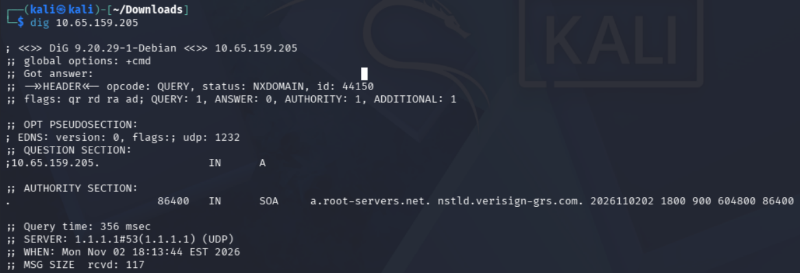
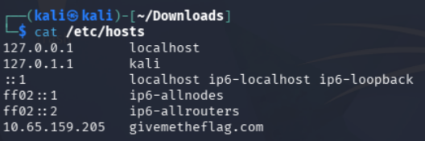
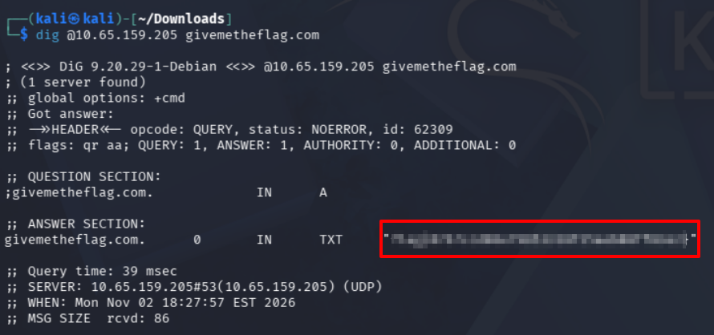

This CTF instructs us to `dig` the target machine to get started.

*Figure 1: dig [target IP]*

The hint also says it only responds to a request from `givemetheflag.com`. Add this URL to the `/etc/hosts` file.

*Figure 2: Updated etc/hosts*

Now, `dig` the target IP again with `dig @[target IP] givemetheflag.com`. The `@` tells `dig` to skip looking in `/etc/resolv.conf` and to treat the IP as a name server.

*Figure 3: Flag*

The flag appears, so the CTF is complete!
